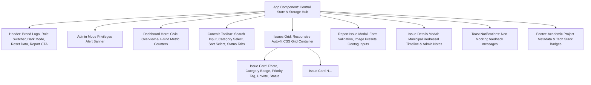

# 👁️ JanNetra - Civic Issue Management Portal
> **Academic Mini-Project Evaluation — 5th Semester Computer Science & Engineering**  
> *A Modern, Responsive Municipal Grievance Redressal & Civic Intelligence System*

---

## 📌 1. Project Overview & Problem Statement

In rapidly expanding urban municipalities, civic infrastructure issues such as **hazardous potholes, failed streetlights, overflowing waste dumpsters, contaminated water pipeline leaks, and broken drainage grates** frequently go unaddressed due to fragmented communication channels between citizens and local administrative bodies.

**JanNetra** (derived from Sanskrit *Jan* [People] + *Netra* [Eye/Vision]) is a frontend civic intelligence portal designed to bridge this divide. It provides citizens with an intuitive interface to report public infrastructure failures with photographic evidence and geotags, while offering municipal authorities an administrative dashboard to review, triage, update redressal statuses, and maintain a publicly verifiable audit trail.

---

## 🚀 2. Key Features & Academic Requirements Checklist

| Requirement | Implementation in JanNetra | Academic Evaluation Scope |
| :--- | :--- | :--- |
| **Interactive Dashboard** | Responsive CSS Grid featuring 6 preloaded civic complaints with category icons, priority tags, ward locations, timestamps, and status badges. | CSS Grid / Flexbox, Component Composition |
| **Grievance Submission Form** | Floating modal dialog with field validation, preset municipal photographic proofs, custom image URL/upload support, and instant optimistic prepend to top. | React State Management, DOM Events, Form Validation |
| **Real-time Search & Filtering** | Instant debounce-free filtering by title, ward, description, or ID; multi-category dropdown; 4-stage status tabs; 4 sort orders; hotkey `/` focus. | `useMemo`, Array Higher-Order Functions (`filter`, `sort`) |
| **Dual Role Views** | Toggle between **Public Citizen Mode** (upvoting, reporting, timeline viewing) and **Municipal Admin Mode** (inline status transitions, official audit notes). | Conditional Rendering, Role-based UI States |
| **Audit Trail & Lifecycle** | Detailed timeline modal documenting the grievance journey from registration to field inspection and final resolution. | Component Modularity, Timeline Data Structures |
| **Persistent Storage** | Automatic synchronization to browser `localStorage` (`jannetra_issues_v1`); includes an instant **Reset to Sample Dataset** button. | Web Storage API, Defensive Serialization |
| **Data Export & Reporting** | One-click CSV database export and print-optimized stylesheet (`@media print`) for official municipal report printing. | Blob / Data URI generation, CSS Print Media Queries |
| **Design System & Dark Mode** | Curated palette (Civic Navy, Teal, Amber, Emerald), modern typography (Inter & Outfit), glassmorphism, smooth micro-animations, and light/dark theme toggle. | CSS Custom Properties (Variables), Responsive Media Queries |

---

## 🏗️ 3. System Architecture & Component Hierarchy

The application follows a modular, uni-directional React architecture:



---

## 💻 4. Technology Stack & Design Decisions

- **Frontend Library:** React 18 (Hooks: `useState`, `useEffect`, `useMemo`, `useRef`)
- **Markup:** Semantic HTML5 (`<header>`, `<main>`, `<section>`, `<article>`, `<aside>`, `<footer>`)
- **Styling:** Custom Vanilla CSS3 (Pure CSS custom variables, Flexbox for directional layouts, CSS Grid for 2D dashboards and card auto-wrapping)
- **Typography:** Google Fonts (`Outfit` for geometric headings, `Inter` for interface clarity, `JetBrains Mono` for tracking IDs)
- **Persistence:** HTML5 `localStorage` API
- **Deployment Compatibility:** Fully standalone with zero runtime build dependencies. Can run via `file://` directly or over any HTTP server (`npx serve`, Python, Vite, Live Server).

---

## 📁 5. Directory Structure

```text
mini project/
├── index.html           # Main HTML5 entry point & metadata
├── package.json         # Project metadata & npm preview scripts
├── README.md            # Comprehensive academic submission report
├── css/
│   └── styles.css       # Complete Vanilla CSS design system & animations
└── js/
    ├── data.js          # Mock dataset, categories, preset images & storage helpers
    ├── app.jsx          # Human-readable React 18 JSX source code (for grading/viva)
    └── app.js           # Ready-to-run browser distribution bundle
```

---

## ⚡ 6. How to Run the Project

### Method 1: Instant Direct Launch (Zero Installation)
Simply **double-click** `index.html` from Windows File Explorer. It opens directly in Google Chrome, Microsoft Edge, Mozilla Firefox, or Safari without requiring any servers or node installations.

### Method 2: Local HTTP Server via Node.js
If Node.js is installed on your system:
```bash
# Start local preview server on port 3000
npm start
```
Then open: `http://localhost:3000`

### Method 3: Local Server via Python
```bash
# Python 3 built-in server
npm run serve
# or directly:
python -m http.server 3000
```
Then open: `http://localhost:3000`

### Method 4: Visual Studio Code Live Server
Right-click `index.html` inside VS Code and choose **"Open with Live Server"**.

---

## 🧪 7. Walkthrough & Evaluation Demonstration Script

When presenting this project to an evaluator, follow this step-by-step demonstration:

1. **First Impression & Statistics:**
   - Point out the 4 metric cards at the top: *Total Grievances (6)*, *Pending (2)*, *In Progress (2)*, *Resolved (2)*, with dynamic percentage calculation (*33%*).
   - Demonstrate the **Dark Mode** toggle in the top-right navbar. Note how all surface colors, shadows, and contrast adapt gracefully using CSS variables.

2. **Real-Time Search & Multi-Faceted Filtering:**
   - Press `/` on your keyboard to demonstrate the hotkey shortcut focusing the search bar.
   - Type `"pothole"` or `"Ward 24"` — notice instant filtering across multiple card fields (title, ward, description, ID).
   - Click the status pills (`Pending`, `In Progress`, `Resolved`) to verify real-time status count badges.
   - Filter by Category (e.g. *Water Supply & Leakage*) and Sort by *Highest Priority* or *Most Upvoted*.
   - Click `"Reset filters"` to return to the full list.

3. **Submitting a New Civic Grievance:**
   - Click the prominent **"+ Report Issue"** button.
   - Fill in:
     - **Title:** `Broken Water Main on Central Avenue`
     - **Category:** `Water Supply & Leakage`
     - **Urgency:** `Critical`
     - **Location:** `Opposite Metro Gate 3, Sector 9`
     - **Description:** `High pressure pipeline breach causing service road flooding and traffic congestion.`
     - **Photographic Proof:** Click one of the preset photo thumbnails or paste an image URL.
   - Click **"Submit Civic Grievance"**.
   - Notice that the new issue is instantly assigned a tracking ID (`JN-2026-XXXX`), prepended to the top of the grid with an optimistic UI update, the *Total* and *Pending* stats increase by 1, and a success toast notification appears.

4. **Citizen Engagement (Upvoting):**
   - Click the `▲ Upvote` button on any card.
   - Notice the vote counter increments dynamically, the button changes to an active red accent, and state is preserved across page refreshes (`F5`).

5. **Municipal Administrator Mode:**
   - In the header, toggle the view mode switch from **👤 Citizen** to **🛡️ Admin**.
   - Note the appearance of the purple administrative banner with elevated privileges.
   - On any card, use the inline status dropdown to transition an issue from **🟡 Pending** to **🔵 In Progress** or **🟢 Resolved**.
   - Open the **Timeline →** modal to view the timestamped audit log detailing every action taken by the municipal authority.

6. **Reporting & Data Export:**
   - Click **"📊 Export CSV"** to generate and download a clean CSV file containing all registered issues.
   - Click **"🖨️ Print Report"** (or press `Ctrl + P`) to show how `@media print` eliminates UI controls and formats a clean municipal grievance report ready for paper archiving.

7. **Resetting Demo Data:**
   - Click the **🔄 Reset** icon button in the header to safely restore the database to the default sample dataset at any time.

---

## 🎓 8. Viva Voce & Technical Defense Q&A (Academic Preparation)

### Q1: Why did you choose React for this frontend project?
> **Answer:** React's component-based architecture enables clean separation of concerns (Header, Cards, Modals, Stats). Its declarative state model (`useState`) and unidirectional data flow ensure that when a citizen reports an issue or an admin updates a status, the dashboard grid, metric counters, and search filters re-render automatically without manual DOM manipulation.

### Q2: How does `useMemo` improve application performance in this portal?
> **Answer:** Both the multi-criteria search/filtering algorithm and the dashboard metric calculations are wrapped in React's `useMemo` hook. This ensures that expensive array filtering, keyword matching, and sorting only re-execute when their direct dependencies (`issues`, `searchQuery`, `statusFilter`, `categoryFilter`, `sortBy`) change, preventing redundant recalculations during unrelated renders like modal open/close or theme toggle.

### Q3: Why is Vanilla CSS with Flexbox & CSS Grid preferred here over TailwindCSS or Bootstrap?
> **Answer:** Building with Vanilla CSS demonstrates core competency in modern web standards. We utilized **CSS Grid** with `repeat(auto-fill, minmax(360px, 1fr))` to provide intrinsically responsive card layouts that adapt to any screen width without requiring rigid media queries. **Flexbox** was leveraged for 1-dimensional alignments (navbars, card headers, footer rows). CSS Custom Properties (`--bg-surface`, `--primary`) make theme switching performant without stylesheet duplication.

### Q4: How is data persistence handled without an active backend server?
> **Answer:** The application uses the HTML5 `localStorage` API. On first boot, `JanNetraData.getStoredIssues()` checks if the key `jannetra_issues_v1` exists. If empty, it seeds the storage with 6 realistic Indian municipal complaints. Every state modification (`setIssues`) triggers a `useEffect` synchronization hook that serializes the updated state to `localStorage`, ensuring data survives tab closures and page refreshes.

### Q5: How is optimistic UI update implemented during grievance submission?
> **Answer:** When a citizen submits the modal form, the application does not wait for a simulated round-trip delay. It immediately constructs a new complaint object with a unique timestamp and tracking token, prepends it to the `issues` state array using `[newIssue, ...prevIssues]`, updates the dashboard and metric cards instantly, and displays a reassuring toast notification to provide immediate user feedback.

---

## 📜 9. License & Academic Integrity

This project is developed solely for **academic evaluation and demonstration** for the 5th-Semester Computer Science and Engineering curriculum.  
All mock data, locations, and imagery are simulated for educational illustrative purposes.
